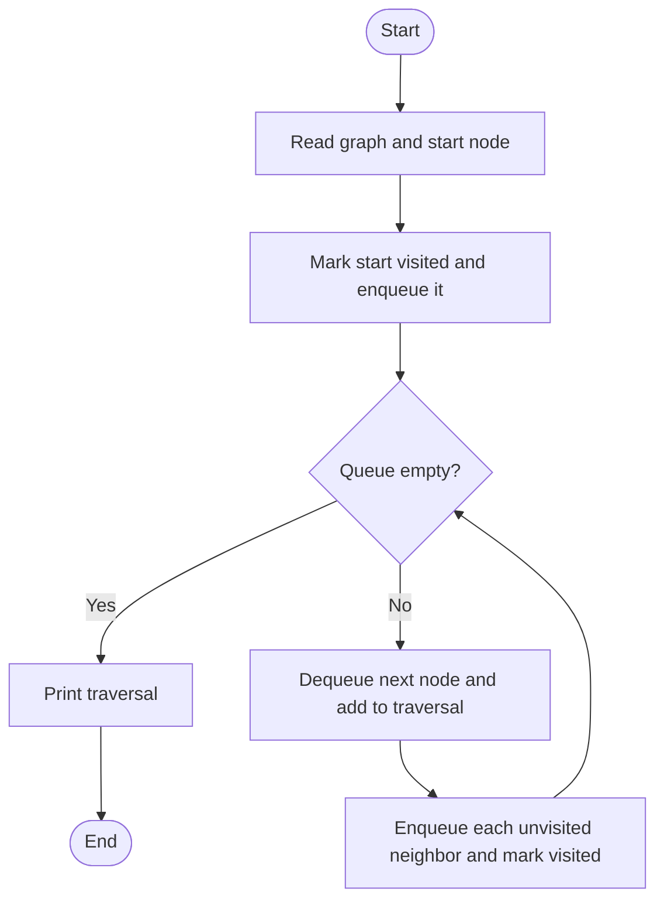
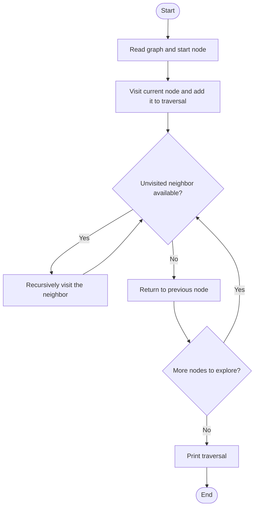
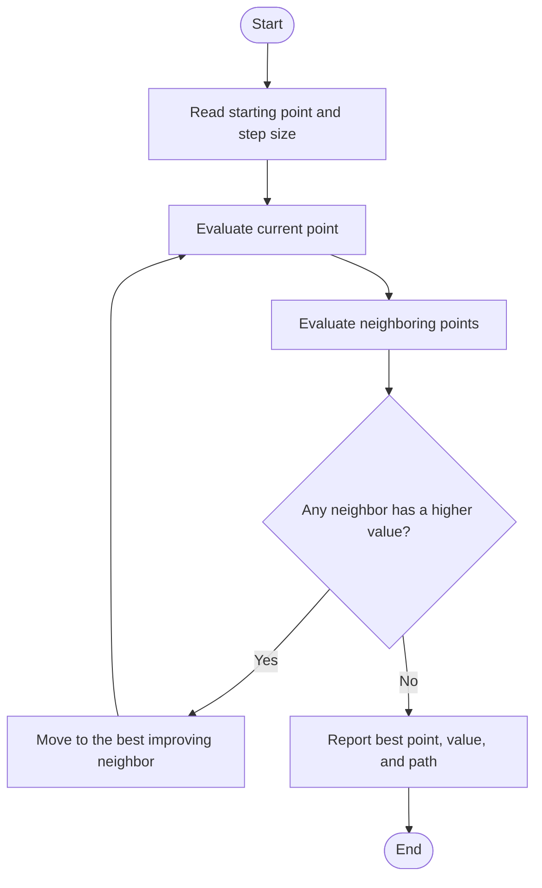
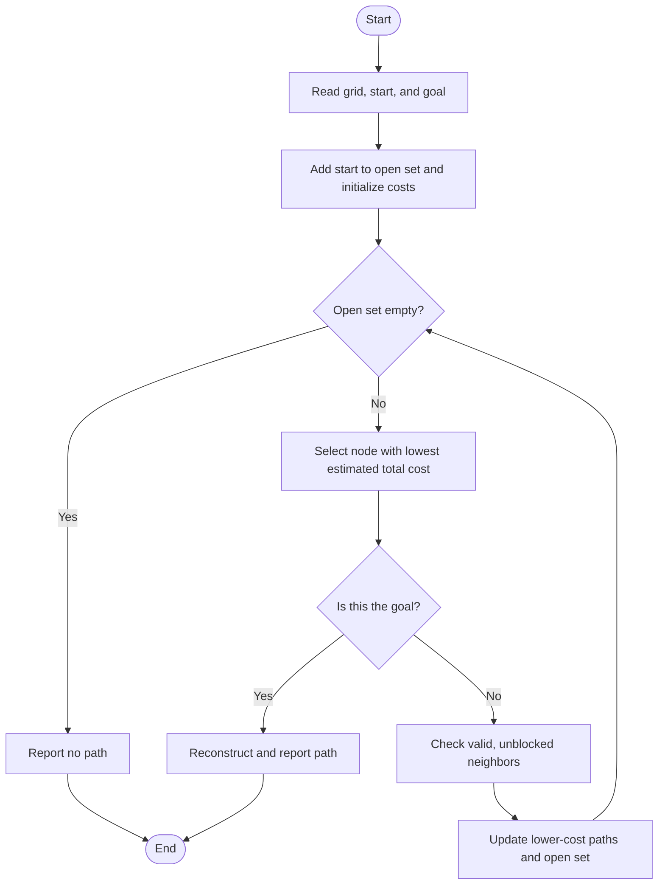
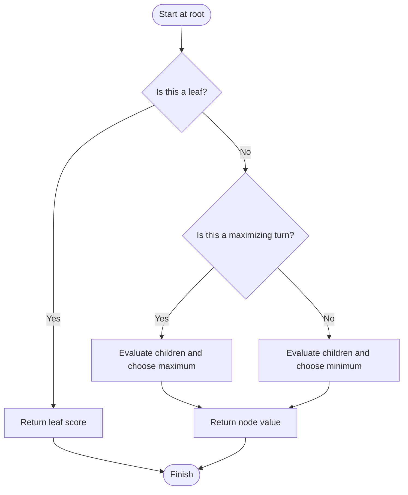
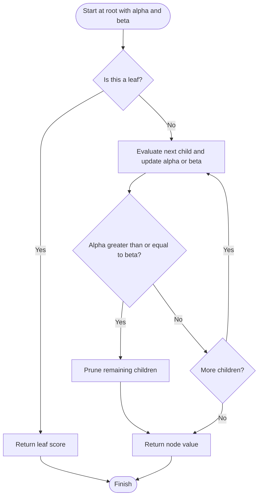
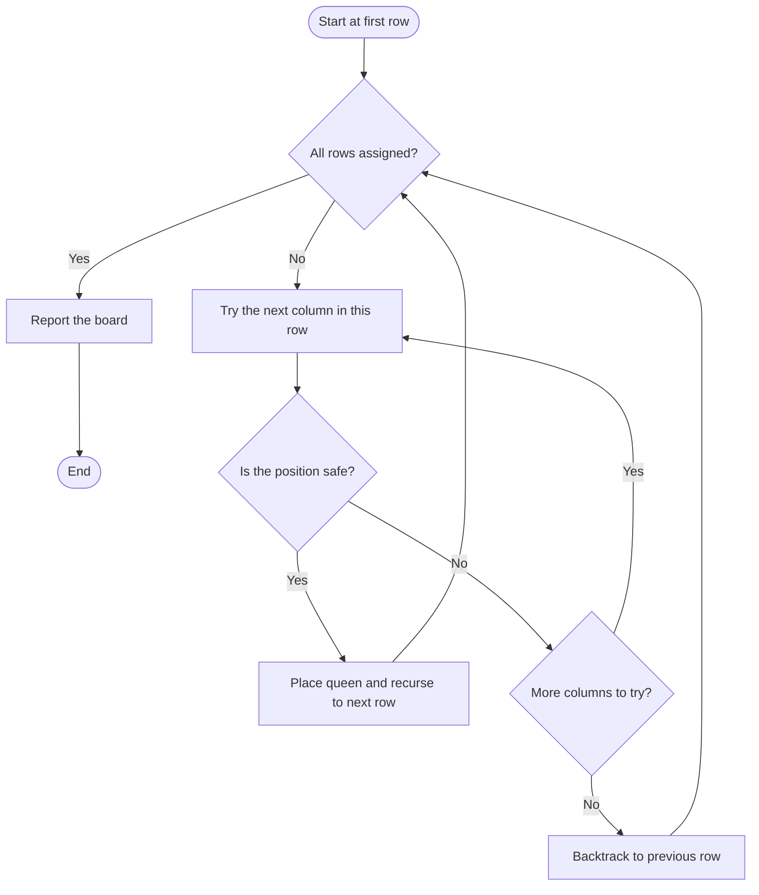
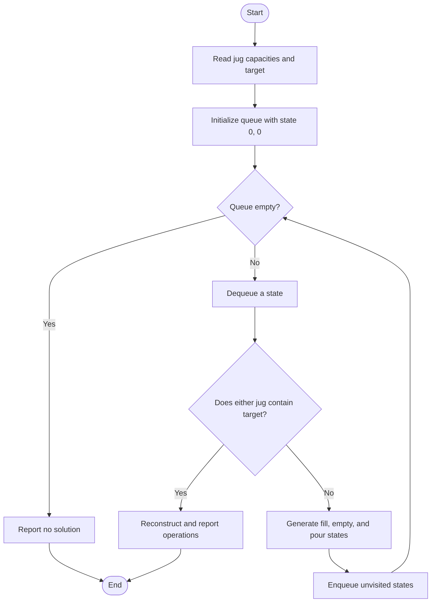
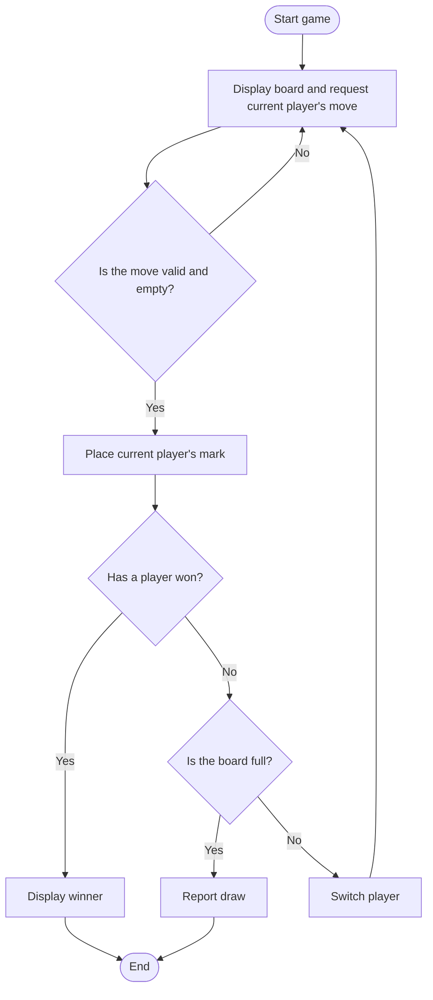
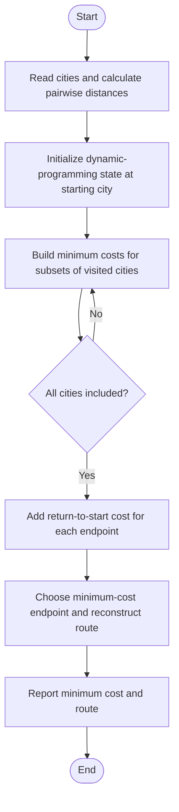

# Artificial Intelligence Lab Experiments

## Question-wise Report and Sample Terminal Outputs

This report documents the ten AI lab programs in this repository. Each section gives the question, the sample input used, the output captured from the program, and a flow diagram of the main algorithm.

> **Output note:** The transcripts below preserve the output captured when each script was run with the listed input. Prompt lines may appear joined because input was supplied non-interactively.

## Contents

1. [Breadth-First Search](#q1-breadth-first-search-bfs)
2. [Depth-First Search](#q2-depth-first-search-dfs)
3. [Hill Climbing](#q3-hill-climbing-algorithm)
4. [A* Search](#q4-a-algorithm)
5. [Minimax](#q5-min-max-algorithm)
6. [Alpha-Beta Pruning](#q6-alpha-beta-pruning)
7. [8-Queens](#q7-8-queens-problem)
8. [Water Jug Problem](#q8-water-jug-problem)
9. [Tic-Tac-Toe](#q9-tic-tac-toe-game)
10. [Travelling Salesman Problem](#q10-travelling-salesman-problem)

## General Instructions

- **Language:** Python 3
- **Run a program:** `python Q1.py` (replace `Q1.py` with the question's filename)
- Enter input in the format shown in that question's sample input.
- The flow diagrams use Mermaid and render in Markdown viewers that support Mermaid.

---

## Q1. Breadth-First Search (BFS)

**Program:** [`Q1.py`](./Q1.py)  
**Aim:** Traverse a graph level by level from a given starting node using a queue.

**Sample input**

```text
{'A':['B','C'],'B':['D'],'C':['E'],'D':[],'E':[]}
A
```

**Captured terminal output**

```text
Enter adjacency list as a Python dictionary literal (example: {'A': ['B', 'C'], 'B': ['D']}): 
Enter start node: BFS traversal from A : ['A', 'B', 'C', 'D', 'E']
```

**Flow diagram**



---

## Q2. Depth-First Search (DFS)

**Program:** [`Q2.py`](./Q2.py)  
**Aim:** Traverse a graph by exploring each branch as far as possible before backtracking.

**Sample input**

```text
{'A':['B','C'],'B':['D'],'C':['E'],'D':[],'E':[]}
A
```

**Captured terminal output**

```text
Enter adjacency list as a Python dictionary literal: 
Enter start node: DFS traversal from A : ['A', 'B', 'D', 'C', 'E']
```

**Flow diagram**



---

## Q3. Hill Climbing Algorithm

**Program:** [`Q3.py`](./Q3.py)  
**Aim:** Repeatedly move to a neighboring point with a higher objective value until no improving move is available.

**Sample input**

```text
0
0
1
```

**Captured terminal output**

```text
Enter start x: Enter start y: Enter step size: Hill climbing path: [(0, 0), (1, 1), (2, 2), (3, 3), (3, 4)]
Best point: (3, 4)
Best value: 10
```

**Flow diagram**



---

## Q4. A* Algorithm

**Program:** [`Q4.py`](./Q4.py)  
**Aim:** Find a path through a grid using path cost and a Manhattan-distance heuristic.

**Sample input**

```text
[[0,0,0],[0,0,0],[0,0,0]]
(0,0)
(2,2)
```

**Captured terminal output**

```text
Enter grid as a list of lists (0 = free, 1 = wall):
Enter start position as a tuple (row, col): Enter goal position as a tuple (row, col): Shortest path: [(0, 0), (0, 1), (0, 2), (1, 2), (2, 2)]
```

**Flow diagram**



---

## Q5. Min-Max (Minimax) Algorithm

**Program:** [`Q5.py`](./Q5.py)  
**Aim:** Compute the game-tree value by alternating maximizing and minimizing choices.

**Sample input**

```text
{'A': {'B': 5, 'C': 3}}
```

**Captured terminal output**

```text
Enter game tree as a nested dictionary (example: {'A': {'B': 5, 'C': 3}}):
Minimax value: 3
```

**Flow diagram**



---

## Q6. Alpha-Beta Pruning

**Program:** [`Q6.py`](./Q6.py)  
**Aim:** Compute the minimax result while skipping branches that cannot affect the final decision.

**Sample input**

```text
{'A': {'B': 5, 'C': 3}}
```

**Captured terminal output**

```text
Enter game tree as a nested dictionary (example: {'A': {'B': 5, 'C': 3}}):
Alpha-beta result: 3
```

**Flow diagram**



---

## Q7. 8-Queens Problem

**Program:** [`Q7.py`](./Q7.py)  
**Aim:** Place eight queens on an 8 × 8 chessboard so that no two queens attack each other.

**Sample input**

```text
8
```

**Captured terminal output**

```text
Enter board size (default 8): One valid arrangement for 8 queens:
Q . . . . . . .
. . . . Q . . .
. . . . . . . Q
. . . . . Q . .
. . Q . . . . .
. . . . . . Q .
. Q . . . . . .
. . . Q . . . .
```

**Flow diagram**



---

## Q8. Water Jug Problem

**Program:** [`Q8.py`](./Q8.py)  
**Aim:** Find a sequence of valid jug operations that leaves the target amount in either jug.

**Sample input**

```text
3
4
2
```

**Captured terminal output**

```text
Enter capacity of jug A: Enter capacity of jug B: Enter target amount: Solution steps:
(0, 0) -> None
(3, 0) -> Fill jug A
(0, 3) -> Pour A into B
(3, 3) -> Fill jug A
(2, 4) -> Pour A into B
```

**Flow diagram**



---

## Q9. Tic-Tac-Toe Game

**Program:** [`Q9.py`](./Q9.py)  
**Aim:** Run a two-player, turn-based Tic-Tac-Toe game and report a win or draw.

**Sample input**

```text
1
```

**Captured terminal output**

```text
   |   |   
---+---+---
   |   |   
---+---+---
   |   |   
Player X, choose a position (1-9):  X |   |   
---+---+---
   |   |   
---+---+---
   |   |   
Player   wins!
```

> **Observed behavior:** With the current implementation, the game reports a win after the first move on an otherwise empty board. This occurs because the winner check treats a blank space (`' '`) as a truthy value. The transcript above records the program's current output; it is not a valid winning game state.

**Flow diagram**



---

## Q10. Travelling Salesman Problem

**Program:** [`Q10.py`](./Q10.py)  
**Aim:** Find a minimum-cost tour that visits each city once and returns to the starting city. Distances are calculated using Manhattan distance.

**Sample input**

```text
{'A': (0,0), 'B': (1,3), 'C': (2,1), 'D': (4,2)}
```

**Captured terminal output**

```text
Enter city coordinates as a dictionary like {'A': (0, 0), 'B': (1, 3)}: 
Minimum route cost: 14
Route: A -> C -> D -> B
```

**Flow diagram**



---

## Conclusion

The experiments demonstrate uninformed and heuristic graph search, local optimization, adversarial search, backtracking, state-space search, a simple two-player game, and dynamic programming for route optimization.
